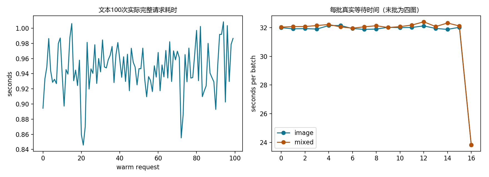

# 别再把 Embedding 当聊天模型！RDK X5 跑通 Google EmbeddingGemma 2：图文检索、批处理提速约 2.7 倍与浏览器实战

> 一篇从“为什么它不会回答问题”开始的实战教程。先跑通 CPU 语义检索，再看 BPU 混合精度、内存分段、性能验收和局域网网页测试。文中实测来自本项目 2026 年 10 月 9 日的记录；整理日期为 2026 年 10 月 10 日。


## 1. 先弄清楚：我们到底部署了什么？

如果你输入“怎么连接无线网络”，页面却显示“最接近的候选：一台工业机器人正在工作”，第一反应很可能是：模型坏了？量化把它弄傻了？

这里首先是**产品用途和测试界面不匹配**。页面把输入编码成向量，再从几条预设描述中找最接近的一条。候选列表如果只有猫、桥、厨房、机器人，就算你的问题和它们都没有关系，排序程序仍然会返回第一名。它没有生成无线网络配置教程。

EmbeddingGemma 2 的主要输出是 **768 维向量**。Google 将它定位为统一文本、图像等输入的语义表示模型，用于检索、分类、聚类以及 RAG 的检索环节。它不是负责逐字生成答案的聊天模型。[Google 官方模型卡](https://ai.google.dev/gemma/docs/embeddinggemma/model_card_2)

可以把它理解成“资料库的语义搜索器”：你问“连不上路由器怎么办”，它找到“检查 Wi-Fi 密码与频段”那段资料；若想把这些资料组织成自然语言答案，还要接入另外一个生成模型。

本项目实现的是：

- 文本 → 向量 → 候选文本相似度排序。
- 图片 → 向量 → 图片对应的文字描述检索。
- 图片和文字共同输入 → 向量 → 候选描述检索。
- 同一局域网内通过浏览器提交输入，查看真实板端耗时和向量。

音频、原生视频、开放域聊天、机器人控制都不在本次验收范围内。四张猫图片来自同一个视频片段的相关帧，也不能算四个独立场景。

公开仓库不附带第三方测试图片；样例来源与 SHA 见 `evidence/sample_sources.json`。

## 2. 读完之后，你能完成什么？

建议按两个层次学习。

**路线 A：CPU 入门。** 准备官方模型，在 X5 上运行一个有实际内容的文本资料检索。该路线不需要量化工具链，也不需要本项目的 BPU 编译产物。

**路线 B：BPU 部署。** 在拥有匹配的九个模型文件、运行库与清单后，启动局域网测试室，理解图片预处理、分段视觉计算、融合模型和验收口径。

高级量化源码也放进准备目录，但它依赖历史 ONNX、校准数据、独立 HBM 缓存与厂商 SDK。**本源码准备包没有这些大型外部产物，因此不是从空目录一键重建 BPU 的完整发行版。** 第 11 节明确列出复现依赖和执行顺序，缺依赖时不要直接运行实验脚本。

## 3. 硬件、环境与文件布局

本次实测使用 RDK X5，8 GB 内存，Ubuntu 22.04.5，Linux 6.1.83，8 个 Cortex-A55 CPU 核心。CPU 比较固定使用四线程、FP32、eager attention。记录到的 CPU 最高频率为 1.5 GHz；本项目没有修改系统时钟和 ION 配置。

板端依赖记录为 Python 3.10、PyTorch `2.14.1+cpu`、torchvision `0.29.1+cpu`、Transformers `5.19.0`、Sentence Transformers `6.1.0`。这是**本项目已验证组合**，不是对所有系统的通用兼容承诺。安装前检查当前官方源是否提供对应 ARM64/Python wheel；若不存在，先解决版本兼容，不要随意替换后沿用本文性能结论。

编译主机和开发板是两个环境：既有 Docker 工具链使用 hb_mapper 1.24.3、hbdk 3.49.15，项目挂载到容器 `/work`。厂商编译环境与模型导出环境隔离，避免更新 PyTorch 破坏厂商 Python 依赖。

准备包的主要布局如下：

```text
RDKX5_EmbeddingGemma2/
├── BLOG.md                       本教程
├── README.md                     阅读入口
├── requirements.txt              已验证板端依赖记录
├── scripts/                      Python/C++ 源码与启动脚本
├── web/                          浏览器页面
├── examples/documents.json       自编文本检索示例
├── assets/                       自绘流程图、实测统计图
├── evidence/                     精简验收证据与候选 SHA
├── docs/                         实验步骤、外部产物与来源说明
└── RELEASE_CHECKLIST.md          正式公开前核对清单
```

运行时另外需要 `model/`、`samples/`、`bpu/runtime/` 和指定 `bpu/vision_trim576/…` 目录。这些目录的位置是接口契约，不要把文件任意改名后期望程序自动发现。

## 4. 第一步：检查开发板，再准备 CPU 环境

以下命令在**开发板 Bash**执行。以 `~/embeddinggemma2_lab` 为例，你也可以改为自己的目录。把准备包内容复制到该目录，不要只复制 `scripts/`。

```bash
cd ~/embeddinggemma2_lab
uname -a
uname -m
python3 --version
free -h
df -h .
mkdir -p logs results
```

先确认是 ARM64、磁盘有余量、没有其他大型推理任务占用内存。模型权重文件约 1.49 GB，模型目录还包含分词器等文件；虚拟环境和量化中间产物会额外占空间。不要按权重大小估算整个工程磁盘预算。

新环境才执行安装；已有验证环境直接复用，不要反复安装。

```bash
python3 -m venv .venv
.venv/bin/python -m pip install --no-cache-dir \
  'torch==2.14.1+cpu' 'torchvision==0.29.1+cpu' \
  --index-url https://download.pytorch.org/whl/cpu
.venv/bin/python -m pip install --no-cache-dir -r requirements.txt
.venv/bin/python -m pip check
.venv/bin/python -c 'from transformers import EmbeddingGemma2Model, EmbeddingGemma2Processor; import torch; print(torch.__version__); print("MODEL_CLASSES_OK")'
.venv/bin/python -m pip freeze > logs/pip-freeze.txt
```

**成功标志：** `pip check` 没有依赖冲突，模型与处理器类可导入。这里只证明环境接口就绪，还没有证明模型能够推理。

## 5. 第二步：准备官方权重，固定版本

本次使用官方仓库 `google/embeddinggemma-2` 的快照：

```text
914f7f89142e33e77833254d9c9b90c3cef7303b
```

权重获取入口是 [Google 官方 Hugging Face 仓库](https://huggingface.co/google/embeddinggemma-2)。正式使用前检查仓库许可、下载条件和目标快照。Google 模型卡标注 Apache 2.0；这不自动覆盖本项目的厂商 SDK、示例图片或视频。[模型卡许可说明](https://ai.google.dev/gemma/docs/embeddinggemma/model_card_2)

本准备包没有复制权重。已有模型可按下列结构放置，并复用已有下载校验清单：

```text
model/
  model.safetensors
  config.json
  modules.json
  config_sentence_transformers.json
  tokenizer.json
  tokenizer.model
  tokenizer_config.json
  preprocessor_config.json
  processor_config.json
  ...其余官方快照文件
```

确实需要首次下载时，在开发板项目根目录运行：

```bash
.venv/bin/python scripts/download_model.py
```

这个脚本会访问网络、读取固定快照的文件大小与 LFS SHA256，校验下载内容，并写入 `logs/model_manifest.json`。它不是断点续传工具；异常时有有限重试。已有正确缓存无需再次执行。如果下载需要身份凭据，请按官方方式在自己的环境配置，不能把令牌写进源码或提交到仓库。

## 6. 第三步：做一个真正有意义的文本检索

示例库 `examples/documents.json` 使用自编内容，覆盖 Wi-Fi 排障、BPU 内存、模型用途和向量相似度。输入一个问题，检索器返回相近的**现有资料**。

```bash
cd ~/embeddinggemma2_lab
mkdir -p results
.venv/bin/python scripts/infer.py \
  --query '连不上无线网络，应该先检查什么？' \
  --documents examples/documents.json \
  --threads 4 --dimension 768 \
  --output results/wifi_retrieval.json
```

CPU 脚本对查询使用 `SearchQuery`，对资料使用 `Document`，并进行 L2 归一化。Google 官方建议为不同检索任务使用对应前缀；这与“给聊天模型写 system prompt”是两回事。[官方任务前缀说明](https://ai.google.dev/gemma/docs/embeddinggemma/model_card_2)

**你应该检查：** 输出向量长度是 768、元素有限、排名里的第一条是否与 Wi-Fi 相关。这个自编示例是教学练习，本次整理没有重新在板端执行它，因此不把它写成已测的检索正确率。

CPU 脚本可使用 128/256/512/768 维；维度缩短后需要重新归一化，并保持查询与资料维度一致。本项目 BPU 接口验收的是 768 维，不能直接把 CPU 的截断选项当作已验收的 BPU 配置。

### 0.95 到底是什么意思？

我们验收量化模型时比较的是：

```text
同一个输入的 BPU 向量 vs 同一个输入的 FP32 参考向量
```

余弦相似度达到 0.95，表示两个表示方向比较接近，**不等于“回答正确率 95%”**。还要另外验证实际候选检索是否正确。

网页里的分数则比较“输入向量”和“候选向量”，也是相似度，不是概率。任意一个候选库总能排出第一名，第一名却未必相关。真实产品通常需要用领域数据验证拒识阈值和召回质量；当前测试室只显示排序，没有完成通用拒识验收。

## 7. 第四步：理解 BPU 为什么要分段

最开始，视觉整图虽然编译成功，却在开发板加载时失败。修剪到 576 个有效 patch 后，整图仍然失败：分配跟踪记录到存活分配约 739 MB，接下来约 67 MB 的分配失败。这里涉及具体 ION 池和分配方式，不能简单用“板子有 8 GB RAM”解释。

八层半图也没有解决加载问题。最终将 16 层视觉网络按 F32 residual 边界拆为八个两层块。原权重保留，每一块拥有独立编译缓存与模型包，顺序加载、推理、释放。

普通块输入输出是 `(1,768,1,576)`；最后一块包含池化与投影，输出 `(1,512,1,64)`。这 64 个视觉表示被放回融合模型的输入序列。融合固定为 128 tokens，输出归一化的 768 维向量。

不能把“仍然共享整图 PACKED_HBM_MODEL 的子图”当作真正的内存缩减方案。我们最终使用的是独立打包的块，并实测加载与释放。首块新候选 ION 峰值约 210 MB，释放后跟踪存活量回到零；这只是该次跟踪范围内的记录，不代表 Python 整个进程的 RSS 为零。

## 8. 第五步：不是把所有算子改成 INT8，而是修好关键边界

第一次量化后的结果并不好。历史中间候选余弦约 0.935、0.916 的失败记录保留，不能只展示成功版本。

修复过程有两个关键点。

第一，重建转换链后，恢复了被转换流程改变的若干输出精度，先让最终图文语义过关。第二，用官方短 profile 找到 MLP 的 CPU 开销：GELU 三次项系数乘法的输出为 INT32，缺少对应校准边界，后续 Add 回到了浮点 CPU 路径。

隔离的新候选只给 16 个目标系数输出补 INT16 校准边界，阈值来自原三次项校准阈值乘原系数 `0.044715`，显式保留输入 shape，并连接对应 Add。原权重字节和原 Softmax 命名节点字节经过审计，目标之外的关键精度与类型变化也检查过。随后先做两层软件诊断，再做完整 16 层最终语义检查，最后编译首块测性能，有证据后才编剩余七块。

首块 100 次核心均值从旧版本 `882.515 ms` 降到新版本 `387.190 ms`。这是**单块比较**，不能据此宣布整个应用提速 2.279 倍。全链路的数字必须来自全链路测量。

最终视觉 112 个与融合 168 个 Softmax 的计算落在 BPU。仍然存在 CPU 处理和混合精度算子，因此不能称作“整个模型纯 INT8、全部算子在 BPU”。

## 9. 第六步：检查部署材料，再启动网页

这里开始是**已有匹配 BPU 产物的运行路线**。先按 [外部产物清单](docs/ARTIFACTS.md) 放好模型、本地官方权重、示例输入、运行库和清单。新八块 SHA 与原融合 SHA 要匹配，不能混用不同候选。

准备包提供不启动推理的预检：

```bash
cd ~/embeddinggemma2_lab
.venv/bin/python scripts/preflight_release.py --root . --bpu
```

它检查清单结构、九个模型的 SHA、必要模型文件与示例路径、运行库是否存在。预检通过只说明文件契约满足；不能替代官方加载、shape/stride 校验与真实推理。

`bpu/runtime/libembedding_bpu.so` 由板端 C++ 适配源码构建，依赖开发板已安装的厂商 DNN 头文件与库。本包附源码，不附厂商二进制。构建参数应按当前 SDK 的头文件和库位置确定；本次整理没有重编 SDK 适配器，不提供未经核验的通用链接命令。

```bash
sh scripts/start_web_lab.sh
```

另一台同一局域网的电脑打开：

```text
http://你的开发板IP:8088
```

终端可先检查服务：

```bash
curl http://127.0.0.1:8088/api/status
```

状态达到 `ready` 后再提交输入。服务启动时会读取权重并加载融合模型，需要等待初始化。页面不是聊天回答界面，而是输入与候选库的比较界面。

原网页截图包含第三方样例图片，未随公开仓库分发。四种真实板端 API 检查记录见 `evidence/web_api_checks.json`。

### 三个推荐练习

1. **文本检索：** 把候选区替换成 `examples/documents.json` 的资料内容，再输入 Wi-Fi 排障问题。固定 128 tokens 的 BPU 版本只接受短输入；过长时缩短资料，不能静默截断后声称等价。
2. **图片检索：** 使用已准备的桥、厨房或猫图片，候选区写互相可区分的描述。观察第一名和原始向量，而不只看一个分数。
3. **图文联合：** 使用厨房图片和短文字，比较与纯图片输入的排名变化。此处不是模型自动生成图片说明，而是在你提供的描述中选择。

网页 BPU 演示目前对候选进行相同编码比较，没有自动套用 CPU CLI 的 `SearchQuery/Document` 前缀。两条路线的任务格式不同，不能把 CLI 前缀带来的效果算入网页验收结果。

网页会显示输入推理、总耗时、有效 tokens、向量维度和候选缓存命中。首次候选编码会增加总耗时；输入推理时间和整次请求时间不是同一个指标。

服务使用单工作线程串行推理和有界队列，没有多用户生产服务验收。它绑定局域网地址、没有登录认证，应放在可信测试网络中；公网部署需要另外完成认证、限流和安全评审。

结束测试可执行：

```bash
sh scripts/stop_web_lab.sh
```

## 10. 第七步：怎样才算测完？

我们的流程是先精度，再核心，再端到端，不拿“编译成功”当“部署成功”。

| 检查层次 | 实际检查内容 | 本项目结果 |
|---|---|---|
| 文件身份 | 八块视觉与融合模型 SHA | 部署清单锁定、上传匹配 |
| 软件分段等价 | 六图八块串联 vs 完整新量化 latent | 最大绝对误差与 RRMSE 为 0 |
| 板端最终语义 | 32 文本、12 图片/图文对原 FP32 | 最低分别 0.964773、0.963487 |
| 实际检索 | 两组文本、图片/图文 caption 排名 | 文本两组各 8/8、图文 12/12 |
| 核心重复运行 | 同候选视觉块与融合各 100 次 | 确定性检查通过 |
| 完整流程 | 文本、图片、图文各 100 warm | 313 个含 cold 的原始输出完成 |
| 拉回核对 | BPU 输出、summary、日志等 | 319 文件 SHA 匹配 |

100 次图片测试轮转六张图片；它测试运行稳定性，不等于验证 100 个独立场景。CPU 对照是文本 8 次、图片和图文各 18 张 warm 的小样本，不能写成 CPU 也完成 100 次稳定性测试。准备包包含 313 个 BPU 原始输出及对应计时摘要，可按 [证据索引](docs/EVIDENCE.md) 自行核对。

### 真正的速度：分开看吞吐与等待


| 类型 | CPU 对照 | BPU 新候选 | 比值 |
|---|---:|---:|---:|
| 文本完整流程均值 | 2.684 秒 | 0.946 秒 | 约 2.84 倍 |
| 图片批处理，每图加权摊销 | 14.613 秒 | 5.355 秒 | 约 2.73 倍 |
| 图文批处理，每图加权摊销 | 14.578 秒 | 5.377 秒 | 约 2.71 倍 |

批调度让融合模型常驻，每个视觉块加载一次后依次处理六图，再释放。加权摊销定义为 `所有 warm 批次 wall 时间之和 / 实际 warm 图片数`，末批四图，保证恰好 100 张。

六图批次的正常等待中位数约 31.97/32.07 秒。**5.355 秒/图是吞吐摊销，不是单张点击后 5.355 秒返回。** 单张另测三次 warm，图片约 11.47 秒、图文约 11.45 秒；这不是单张 100 次稳定性验收，也没有证明实时视频能力。



完整 BPU 流程的最低 FP32 向量余弦为：文本 0.958444、图片 0.963487、图文 0.966395，检索检查通过。采样温度约 48.57–51.11℃，进程 RSS 采样约 1852–1857 MB；采样范围不能冒充全生命周期峰值。CPU 频率记录包含空闲核，不能看到低频就直接判断热降频。

初始 CPU 查表模型加载与首次融合加载成本单独记录；cold 请求与 warm 请求分开报告。所有这些数值仅对应当前权重、九个编译模型、固定 576 patch/128 tokens 和当前调度。

## 11. 高级读者：量化实验该如何复现？

完整工程的难点不是一行 `hb_mapper` 命令，而是模型拆解、形状固定、校准数据、精度恢复、软件审计和板端内存约束。准备包保留关键实验源码，并在 [实验复现路径](docs/EXPERIMENTS.md) 标出依赖。

执行顺序如下，**只有上一阶段真实 exit 0 与对应 gate 通过才能进入下一阶段**：

1. 获取有合法使用权的官方模型、样例与匹配工具链，固定版本；建立 FP32 文本/图文参考。
2. 用 `export_bpu_vision.py`、`export_bpu_fusion.py` 等源码导出固定接口；核对输入、输出、预处理像素和参考向量。
3. 准备原校准数据，进行混合精度转换。576 patch 必须来自有效 position mask，不能任意删输入 patch。
4. 执行 `probe_mlp_quant_boundary.py --explicit-shapes --full-model`，但它依赖已完成的两层诊断与原量化路径，不能从空目录直接运行。检查权重、Softmax、目标边界和最终 12 例语义 gate。
5. `compile_mlp_boundary_chunk0.py --chunk 0` 先完成软件 slice 等价、映射审计、独立编译与打包。
6. 先部署首块，检查官方加载、输出 shape、边界数值、短 profile 与 100 次核心；确认优化有效再推进其余块。
7. `prepare_mlp_remaining_chunks.py` 准备八块串联等价；`supervise_mlp_remaining.py` 有限监督顺序编译其余块，不盲重试。
8. 全部 SHA 验证后，`validate_mlp_multimodal_board.py` 做新候选完整语义和核心测试。
9. `supervise_mlp_batch_acceptance.py` 先测同配置 CPU，再做 BPU 完整 100 次。拉回原始向量、计时、日志、exit，逐文件 SHA 校验，生成 `report_mlp_acceptance.py` 报告。

这些脚本大量固定了实验输出目录；重复执行可能覆盖报告或失败记录。源码准备包不建议初学者直接批量运行。准备独立项目副本、补齐依赖、核查输出路径后，才执行对应步骤。本次整理只复制与检查源码，没有重新编译或重跑板端实验。

## 12. 常见坑：现象、原因、处理

| 现象 | 优先检查 | 处理思路 |
|---|---|---|
| 输入任何问题都返回猫、桥等描述 | 候选库是否与问题相关 | 换成真实资料库；需要生成答案时另接生成模型 |
| 编译成功，加载却 ION 失败 | 真实加载 exit、存活分配、下一次申请 | 独立小块与释放策略；不要反复跑无法加载的 benchmark |
| Python 环境没有模型类 | 已验证依赖版本与 wheel 架构 | 隔离环境并检查兼容，别混改厂商 Python |
| FP16 得到 NaN 或劣化 | 模型数值范围与 dtype | CPU 基线用 FP32；官方不建议此模型使用 FP16 |
| 图片网格不匹配 | 方形留边、processor position mask | 按验收预处理；不要改 vendor 源码绕过 shape 检查 |
| 文本过长报错 | 固定 128 tokens 接口 | 缩短输入或另行导出验收新配置 |
| 页面一直初始化 | 日志、SHA、缺文件、运行库依赖 | 查 `server.log` 与 `/api/status`，别连续重启并发加载 |
| 耗时看起来特别快 | 是否只测 core、缓存、批次摊销 | 明确包括预处理、加载释放、拷贝、归一化与候选编码的范围 |

## 13. 可以用在哪里，又不能承诺什么？

当前结果支持继续探索局域网资料检索、离线图像建索引、图片与文字统一检索。比如先把设备手册段落、维修记录或图片描述编码存入库，查询时只算输入向量再做相似度检索；资料库大时再评估向量索引工具。

本次并没有完成工业大图库、开放场景、并发、多用户认证与长期生产验证。更没有完成音频或原生视频验收。使用自有数据做检索标注、召回指标、拒识和稳定性测试后，才适合决定生产用途。

## 14. 源码许可与复现范围

本仓库自有源码与教学材料采用 **MIT** 许可，保留仓库已有 LICENSE 与版权声明。官方权重、厂商 SDK、编译模型包和第三方媒体遵守各自许可；这些外部产物没有随仓库分发。含第三方图片的网页截图和样例拼图也没有发布。

参考 [发布清单](RELEASE_CHECKLIST.md)、[第三方资料说明](THIRD_PARTY_NOTICES.md) 和 [源码索引](docs/SOURCE_INDEX.md)。我们提供 SHA 与原始结果口径，是为了让读者知道测的是哪一个版本，也知道哪些结论尚未验证。

### 参考资料

- [Google EmbeddingGemma 2 官方模型卡](https://ai.google.dev/gemma/docs/embeddinggemma/model_card_2)：用途、输入输出、任务前缀、数值精度与许可。
- [官方模型仓库](https://huggingface.co/google/embeddinggemma-2)：快照、文件与模型使用说明。
- [Google Gemma Cookbook](https://github.com/google-gemma/cookbook)：官方示例资料入口；具体媒体许可需单独核对。
- 本项目 [实测摘要](evidence/release_acceptance.json)、[候选与测量指标](evidence/measured_metrics.json)、[复现限制](docs/ARTIFACTS.md)。
