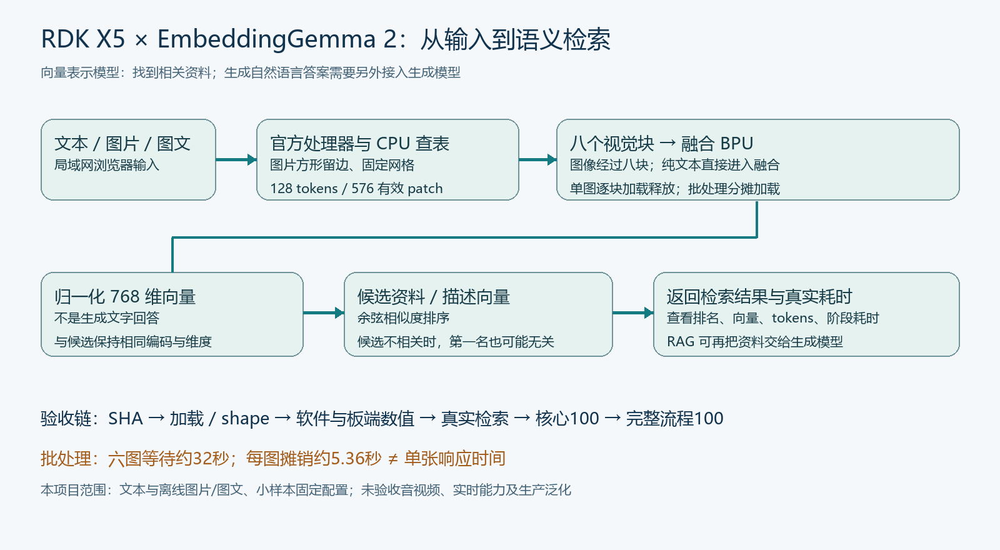
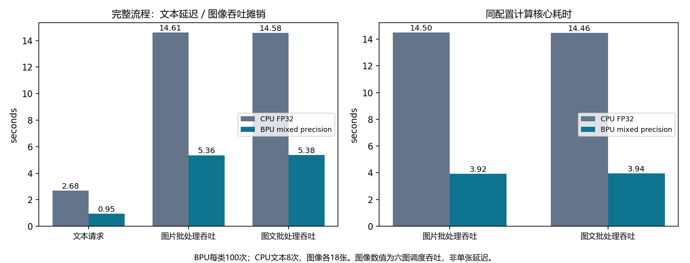

# RDK X5 × Google EmbeddingGemma 2

在 RDK X5 上部署 EmbeddingGemma 2，实现文本、图片与图文联合的向量检索，以及局域网浏览器测试。

**它是 Embedding 模型，输出向量与检索排名，不生成聊天回答。** 本仓库公开部署与实验源码、中文教程和测量证据；权重、厂商 SDK 与编译模型需要另行合法准备。



## 从这里开始

- **[详细附图教学博客](BLOG.md)**：CPU 入门、ION 内存问题、八块视觉分段、MLP 量化边界修复、BPU 部署、网页测试与测速。
- [外部产物清单](docs/ARTIFACTS.md)：哪些文件没有包含，怎样放置已有匹配产物。
- [实验复现路径](docs/EXPERIMENTS.md)、[源码索引](docs/SOURCE_INDEX.md)：高级量化阶段与依赖。
- [证据索引](docs/EVIDENCE.md)：原始向量、逐轮计时、文件 SHA 与 API 检查。

## 实测效果

同 576 有效 patch / 128 tokens、CPU FP32 四线程 eager 的测试配置：

| 输入 | CPU | BPU | 完整流程比较 |
|---|---:|---:|---:|
| 文本 | 2.684 s | 0.946 s | 约 2.84× |
| 图片：六图批处理每图加权摊销 | 14.613 s | 5.355 s | 约 2.73× |
| 图文：六图批处理每图加权摊销 | 14.578 s | 5.377 s | 约 2.71× |



BPU 每类完成 100 次 warm，包含 cold 的原始输出共 313 个；CPU 是文本 8 次、图片和图文各 18 张 warm 的小样本对照。六图批次通常等待约 32 秒，**每图摊销不是单张响应延迟**。单张图片约 11.47 秒、图文约 11.45 秒来自另行三次 warm 诊断，非单张 100 次验收。

完整流程最低 FP32 向量余弦：文本 0.958444、图片 0.963487、图文 0.966395，所测检索检查通过。余弦 0.95 不等于 95% 问答正确率。样例六图中四个猫帧来自同一个 clip，不能当作独立场景。

这是固定配置下的文本与离线图片/图文实验；音频、原生视频、实时多模态、生产泛化与多用户并发未验收。详细范围见 [验收报告](evidence/release_acceptance.json)。

## CPU 文本检索入门

在 ARM64 开发板上克隆项目，准备匹配环境与官方模型；具体安装与下载条件见博客。

```bash
git clone https://github.com/1760hwy/RDKX5_EmbeddingGemma2.git
cd RDKX5_EmbeddingGemma2
# 根据 BLOG.md 创建 .venv，并准备 model/ 官方快照。
mkdir -p results
.venv/bin/python scripts/infer.py \
  --query '连不上无线网络，应该先检查什么？' \
  --documents examples/documents.json \
  --threads 4 --dimension 768 \
  --output results/wifi_retrieval.json
```

此自编资料库用于教学，未作为原板端验收数据集。CPU CLI 使用官方 SearchQuery/Document 前缀；网页候选比较的任务格式不同，不能混用两条路线的精度结论。

## 局域网网页测试

先按 [外部产物清单](docs/ARTIFACTS.md) 提供九个匹配 BPU 模型、清单、官方模型、示例图片与板端适配运行库。

```bash
.venv/bin/python scripts/preflight_release.py --root . --bpu
sh scripts/start_web_lab.sh
# 在同一局域网浏览器打开 http://<BOARD_IP>:8088
```

网页支持短文本、单张图片、图文联合与候选描述排序，显示实际输入推理时间、总耗时、tokens 和 768 维向量。它不接入外部聊天服务，也不自动生成答案。服务没有认证，仅用于可信局域网实验；公网或生产用途需要单独评审。

## 复现与文件边界

本仓库提供源码和证据，**不是空目录一键重建所有 BPU bin 的完整构建发行版**。量化实验依赖历史 ONNX、校准数据、FP32 参考、两层诊断与厂商编译缓存；运行前阅读 EXPERIMENTS.md。多数实验脚本固定输出路径，不能在唯一原始工程中盲目重跑。

公开文件不含权重、ONNX/HBM/bin、SDK、wheel、虚拟环境、私有连接凭据或待授权图片。示例图片来源与 SHA 保留，媒体由使用者依法获取。

## 本地源码检查

```bash
python tools/verify_package.py
```

此检查不下载模型、不连接开发板，也不执行推理。核对 Python 语法、文内链接、复制文件 SHA 和敏感模式。项目发布前检查见 [RELEASE_CHECKLIST.md](RELEASE_CHECKLIST.md)。

## 许可证

自有源码、教程和自绘图采用仓库已有的 **[MIT License](LICENSE)**。官方模型、厂商 SDK 和第三方媒体遵守各自许可，详见 [第三方说明](THIRD_PARTY_NOTICES.md) 与 [许可范围](LICENSE_SELECTION.md)。
