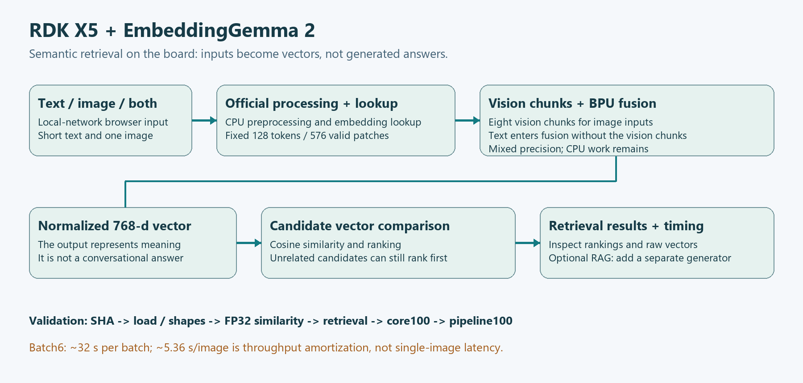
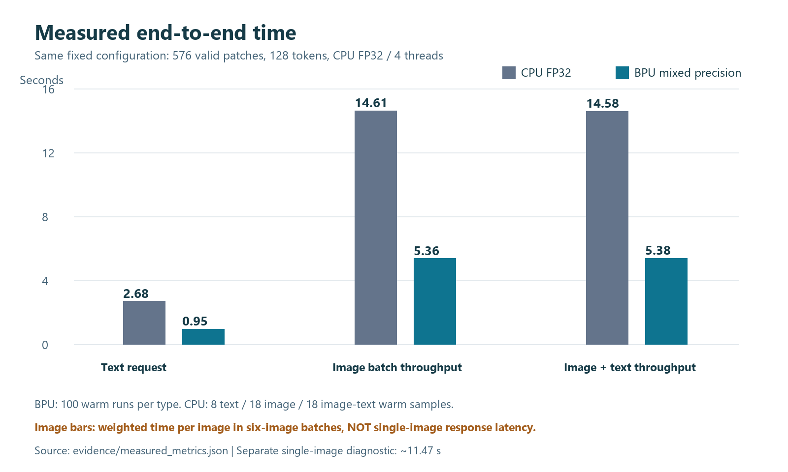

# RDK X5 × Google EmbeddingGemma 2

**English** | [简体中文](README.zh-CN.md)

Text, image, and image–text embedding retrieval on the RDK X5, with a browser-based test interface for your local network.

**This is an embedding model, not a conversational language model.** It returns 768-dimensional vectors and ranks supplied candidates; it does not generate answers. This repository includes deployment and experiment source code, a detailed Chinese tutorial, and measured results. Model weights, vendor SDKs, and compiled BPU models must be obtained separately.



## What is included?

- A CPU text-retrieval CLI using the official `SearchQuery` and `Document` prefixes.
- An eight-chunk vision pipeline and a fusion model, with mixed-precision BPU deployment code.
- A LAN browser interface for short text, a single image, or combined image–text input.
- Quantization diagnostics, numerical checks, benchmark scripts, and 313 raw BPU output vectors.
- A [step-by-step illustrated tutorial (Chinese)](BLOG.md), [source index (Chinese)](docs/SOURCE_INDEX.md), and [evidence index (Chinese)](docs/EVIDENCE.md).

The main quantization changes address GELU/MLP calibration boundaries while retaining the original weight bytes. The tested candidate places all 112 vision and 168 fusion Softmax computations on the BPU. Other processing still uses the CPU; this is not an all-INT8 or entirely BPU-only pipeline.

## Measured performance

The comparison uses the same fixed configuration: 576 valid image patches, 128 tokens, and a four-thread FP32 CPU baseline with eager attention.

| Input | CPU | BPU | End-to-end speedup |
|---|---:|---:|---:|
| Text | 2.684 s | 0.946 s | 2.84× |
| Image — weighted time per image in six-image batches | 14.613 s | 5.355 s | 2.73× |
| Image + text — weighted time per image in six-image batches | 14.578 s | 5.377 s | 2.71× |



The BPU completed 100 warm runs per input type, with 313 total outputs including cold runs. The CPU comparison is a smaller sample: eight warm text runs and 18 warm images per image-based input type. End-to-end batch timing includes source-image processing, model loading/release, transfers, inference, and normalization.

**Batch throughput is not single-image response latency.** A typical six-image batch takes about 32 seconds. A separate three-warm-run diagnostic measured approximately 11.47 seconds for a single image and 11.45 seconds for a single image–text request; this was not a 100-run single-request stability test.

Minimum cosine similarity against the original FP32 output was 0.958444 for text, 0.963487 for images, and 0.966395 for image–text inputs. Retrieval checks passed on the tested samples. A cosine threshold of 0.95 does **not** mean 95% question-answering accuracy.

The six test images include four correlated cat frames from one clip. Results establish a limited fixed-configuration experiment, not independent-scene generalization. Audio, native video, real-time multimodal processing, production generalization, and multi-user concurrency have not been validated. See the [acceptance scope](evidence/release_acceptance.json) and [exact metrics](evidence/measured_metrics.json).

## CPU quick start

### 1. Prepare the environment

The recorded board environment is ARM64 Ubuntu 22.04.5, Python 3.10, PyTorch `2.14.1+cpu`, torchvision `0.29.1+cpu`, Transformers `5.19.0`, and Sentence Transformers `6.1.0`. Check that compatible wheels are available for your platform before installing; these versions describe the tested environment, not universal compatibility.

Run in Bash on the board:

```bash
git clone https://github.com/1760hwy/RDKX5_EmbeddingGemma2.git
cd RDKX5_EmbeddingGemma2
python3 -m venv .venv
.venv/bin/python -m pip install --no-cache-dir \
  'torch==2.14.1+cpu' 'torchvision==0.29.1+cpu' \
  --index-url https://download.pytorch.org/whl/cpu
.venv/bin/python -m pip install --no-cache-dir -r requirements.txt
.venv/bin/python -m pip check
mkdir -p logs results
```

Reuse an existing validated environment instead of reinstalling it.

### 2. Prepare the official model

Obtain the model from [Google's official repository](https://huggingface.co/google/embeddinggemma-2), review its terms, and place the complete snapshot under `model/`. This project used revision:

```text
914f7f89142e33e77833254d9c9b90c3cef7303b
```

For a first download, `scripts/download_model.py` downloads that pinned snapshot and checks file sizes and LFS SHA256 values:

```bash
.venv/bin/python scripts/download_model.py
```

This command accesses the network. Reuse verified existing files when available. Do not commit authentication tokens. CPU inference uses FP32 and local files; do not substitute FP16 without checking the model's numerical requirements.

### 3. Retrieve documents

```bash
.venv/bin/python scripts/infer.py \
  --query 'What should I check when Wi-Fi will not connect?' \
  --documents examples/documents.en.json \
  --threads 4 --dimension 768 \
  --output results/wifi_retrieval.json
```

The result contains a vector and a ranked list of existing documents, not a generated answer. The English sample corpus is an instructional example, not the dataset used for the recorded board acceptance tests.

## LAN browser testing

The browser interface requires the existing accepted BPU artifacts; CPU setup alone does not make the BPU server runnable. Preserve the relative paths specified by [the pipeline manifest](evidence/pipeline_manifest.json):

1. The complete official snapshot under `model/`.
2. Eight matching vision `.bin` files and the matching fusion `.bin`, with the listed SHA256 values.
3. The manifest at `bpu/vision_trim576/mlp_boundary_full16/full_board_inputs/pipeline_manifest.json`.
4. `bpu/runtime/libembedding_bpu.so`, built from `scripts/bpu_persistent_runtime.cpp` against the board's vendor DNN SDK.
5. The required sample files: `samples/GoldenGate.png`, `samples/kitchen_painting.jpg`, and `samples/prepared/video_frames/frame_01.png`. The current engine needs the Golden Gate image as a preprocessing-grid reference even when testing uploaded images. Sources and hashes are recorded in [sample_sources.json](evidence/sample_sources.json); media permissions must be checked separately.

Then run:

```bash
.venv/bin/python scripts/preflight_release.py --root . --bpu
sh scripts/start_web_lab.sh
curl http://127.0.0.1:8088/api/status
```

Wait for `ready`, then open `http://<BOARD_IP>:8088` in a browser on the same LAN. Stop the service with `sh scripts/stop_web_lab.sh`.

The interface shows candidate rankings, input-inference time, total request time, token count, and the 768-dimensional vector. Initial candidate encoding adds to total request time. Replace the preset candidate list with relevant documents: if every candidate is unrelated, the top-ranked result can still be irrelevant.

The web interface currently uses Chinese labels. It uses a different input task format from the CPU CLI; it does not automatically apply the CLI's retrieval prefixes. The server uses a single inference worker and has no authentication. Use it on a trusted test LAN; public or production deployment needs a separate review.

## Reproducibility boundaries

This is a source-and-evidence release, **not a one-command build of every BPU model from an empty directory**. Advanced quantization scripts depend on historical ONNX exports, calibration data, FP32 references, intermediate diagnostics, and vendor compilation caches that are not distributed here. The recorded compiler environment used hb_mapper 1.24.3 and hbdk 3.49.15, separately from the model-export environment.

Consult the [artifact requirements (Chinese)](docs/ARTIFACTS.md) and [experiment sequence (Chinese)](docs/EXPERIMENTS.md) before running those scripts. Many write to fixed experiment paths; use an isolated project copy and inspect dependencies before rerunning.

No weights, ONNX/HBM/bin files, SDKs, wheels, virtual environments, private connection credentials, or unlicensed sample images are included. A clean-environment, independent reproduction of the full BPU build remains outstanding.

## Local source checks

```bash
python tools/verify_package.py
```

This checks Python syntax, Markdown links, source-file hashes, and selected sensitive patterns. It does not download models, contact the board, or validate inference. See the [release checklist (Chinese)](RELEASE_CHECKLIST.md) for remaining work.

## License

Project-owned source code, tutorial materials, and diagrams use the existing **[MIT License](LICENSE)**. The official model, vendor SDKs, and third-party media retain their respective licenses. See [third-party notices (Chinese)](THIRD_PARTY_NOTICES.md) and [license scope (Chinese)](LICENSE_SELECTION.md).
